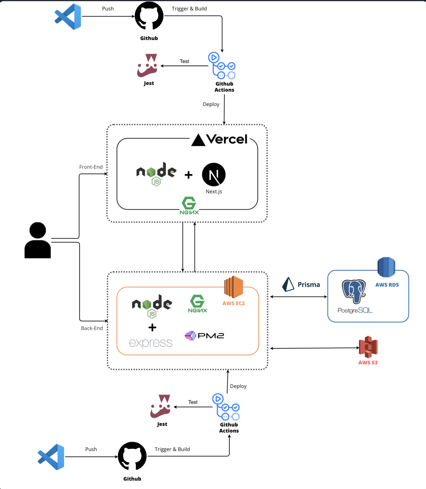

# 무빙 (Moving)

이사 소비자와 이사 전문가(기사님)를 연결하는 견적 매칭 서비스입니다. 코드잇 풀스택 과정 Team 3의 최종 프로젝트입니다.

소비자가 이사 정보를 입력하면 기사님이 견적을 보내고, 소비자는 견적과 이전 고객의 리뷰를 비교해 기사님을 선택합니다.

## 저장소

| 저장소                                               | 설명                                                                                                                                                                            |
| ---------------------------------------------------- | ------------------------------------------------------------------------------------------------------------------------------------------------------------------------------- |
| [moving-fe](https://github.com/fs14-team3/moving-fe) | Next.js 프론트엔드                                                                                                                                                              |
| [moving-be](https://github.com/fs14-team3/moving-be) | Express API, [API 명세](https://github.com/fs14-team3/moving-be/blob/develop/docs/api/openapi.yaml), [ERD](https://github.com/fs14-team3/moving-be/blob/develop/docs/db/erd.md) |

## 아키텍처

- **FE**: Next.js, Vercel 배포
- **BE**: Express + TypeScript, AWS EC2 (PM2 + Nginx)
- **DB / 스토리지**: PostgreSQL 16 (AWS RDS, Prisma), AWS S3
- **CI/CD**: GitHub Actions, 저장소별 독립 파이프라인 (BE 테스트: Vitest)

## 팀

| 이름   | 역할         | 담당                      | GitHub                                           |
| ------ | ------------ | ------------------------- | ------------------------------------------------ |
| 원태웅 | 팀장, 인프라 | 팀 운영, AWS 배포와 CI/CD | [@taewon-wn](https://github.com/taewon-wn)       |
| 채하은 | FE 리드      | 프론트엔드 팀 리더        | [@haeun-chae](https://github.com/haeun-chae)     |
| 이현지 | BE 리드      | 백엔드 팀 리더            | [@userhjwork](https://github.com/userhjwork)     |
| 이강연 | PM           | 요구사항 정리, 일정 관리  | [@kangyeon0413](https://github.com/kangyeon0413) |
| 김민선 | 팀원         | 기능 개발                 | [@aksths](https://github.com/aksths)             |
| 김건우 | 팀원         | 기능 개발                 | [@Kim-Geonwoo](https://github.com/Kim-Geonwoo)   |
